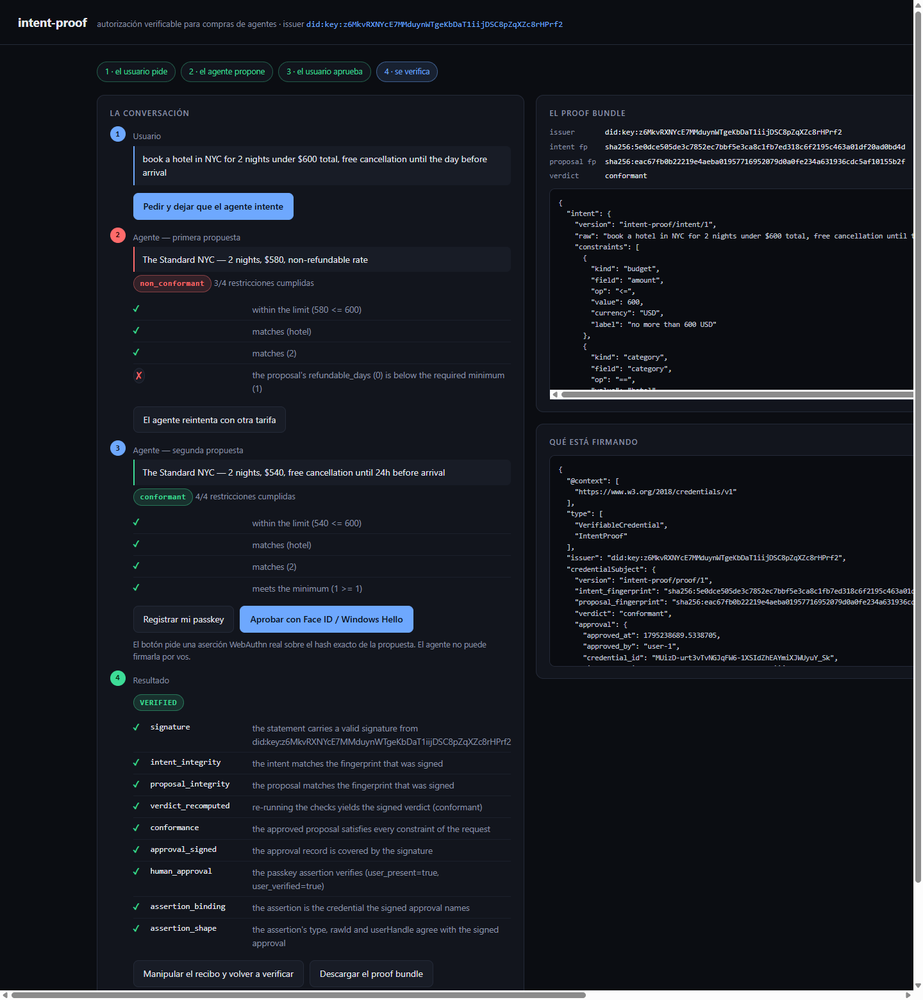

# agent-payments

[](https://api.securityscorecards.dev/projects/github.com/SYNSEMA/agent-payments)

**Verifiable evidence that an AI agent's purchase was requested and approved by a human — and that
the purchase actually met the request.**

A signed, self-contained bundle that lets a third party answer, **offline**, with **public keys
only** and **without trusting the issuer**:

1. What did the user ask for?
2. What did the agent propose?
3. Who authorised it, and when?
4. How much was authorised to be spent?
5. What was bought?
6. **Does the purchase meet the request?**

The sixth question is the one the market does not answer. A $580 **non-refundable** hotel rate
inside a $600 budget passes every approval check — a signature alone cannot tell you the agent
bought the wrong thing.

> The agent proposes. **The proof decides.**

---

## Three ways to use it

This is a **format**, not a service. The recipe is one convenient way in; it is not the only way.

| | How | What you need |
|---|---|---|
| **Deploy it** | `syn deploy --kind web` from this folder — the [Synsema platform](https://synsema.com) CLI, Vercel-style | A platform account |
| **Run it anywhere** | `synsema serve web.syn` | The Synsema engine. No account, no network, no platform |
| **Just verify bundles** | `node reference/ts/verify.mjs bundle.json` | Node 20+. **Nothing else** |

**The verifier never needs this project, this platform, or an account.** It takes one file and the
issuer's public key. That is the point: the evidence has to survive the thing that produced it.

**This recipe is deliberately not filed in the platform's recipe catalogue.** That catalogue is
Vela-era — every entry in it is bound to Horizen's enclave — and it will be rewritten or go with
Vela. This repository is distributed as its own repository, and the format itself is downloaded and
run, with nothing of the platform in the path.

### Where each layer runs

| Layer | Where | Why |
|---|---|---|
| **The format** — spec, verifiers, vectors | **Nowhere.** Downloaded and run. | A third party must be able to verify without our server, our account or our permission |
| **The recipe** — the console | The platform, `kind = "web"` | It has ingress: a browser drives it. Low traffic, one-click, sealed secrets and an audit log |
| **Background work** — re-verifying old bundles, rotating keys, batch exports | The platform, `kind = "worker"` | A worker has **no URL** and is always on: feeds, queues, inboxes. A different shape for work with no ingress |
| **The trust service** — the commercial layer | **A dedicated runner in our own cloud** (or a plain VPS) | Key custody in an HSM, a durable evidence vault, attestation, compliance exports, an SLA, real traffic. A worker is ephemeral and has no stable identity: the wrong shape for money and for a regulator |

The rule: **the platform is the distribution and demonstration channel, not the place where the
money or the keys live.** See [`GOVERNANCE.md`](GOVERNANCE.md) §11.

---

## What is in here

```
spec/SPEC.md              the NORMATIVE specification. Plain text. Readable without Synsema
spec/bundle.schema.json   the JSON Schema of a bundle
spec/pscp/                how the specification changes (Portable Spec Change Proposals)

reference/ts/             reference verifier in TypeScript — ZERO dependencies
reference/rust/           reference verifier in Rust — for the auditor
reference/implementations.md   the registry of independent implementations
testvectors/valid/        bundles that MUST verify
testvectors/invalid/      one file per attack, each that MUST be rejected

src/                      the reference implementation in Synsema
web.syn                   the console: request → proposal → approval → verdict
web/                      the console's UI

scripts/make-vectors.mjs  derives the vectors from the golden file
scripts/verify-vectors.sh runs the Synsema verifier over the whole vector set
research/                 the market research behind the thesis, with sources and dates
```

**Three independent implementations** — Synsema, TypeScript and Rust — reach **the same verdict**
on every vector, and CI runs all three. A divergence is a release blocker.

---

## Quick start

```bash
# the engine
curl -fsSL https://synsema.com/install.sh | sh        # or: npm i -g synsema

# the unit tests (31)
synsema test src/proof.test.syn

# the whole demo in one command
./demo.cmd

# the console
synsema serve web.syn          # http://localhost:8477

# the independent verifier, offline, no dependencies
node reference/ts/verify.mjs src/fixture-bundle.json
cargo test --manifest-path reference/rust/Cargo.toml
sh scripts/verify-vectors.sh
```

---

## The demo

The console shows the whole flow in three panels — **what was asked**, **what the agent proposed**,
**what the human approved** — and then the verdict.

The scenario is a hotel booking where the agent's **first** proposal is inside budget, the right
category, the right number of nights — and **not refundable**, which is exactly the mistake a
budget check does not catch. The console recomputes the constraints and shows the mismatch before
the money moves.

The human approves with a **passkey** (WebAuthn, real — not a checkbox). The resulting bundle is
signed with Ed25519 over a `did:key`, and the verifier checks it with **public keys only**.



---

## How the proof works

Three independent commitments, so no single party can forge the whole:

| | |
|---|---|
| `intent_fingerprint` | a commitment to **what was asked** |
| `proposal_fingerprint` | a commitment to **what was proposed** |
| the approval signature | a commitment that a **human said yes to that exact proposal** |

The signature is a W3C Data Integrity proof (`eddsa-jcs-2022`) over RFC 8785 canonical JSON. The
whole approval record and the whole conformance report live **inside** the signed subject — a field
that is not covered by the signature is a field nobody can defend.

The signed message is **not** the document. It is:

```
SHA-256(JCS(proofConfig)) ‖ SHA-256(JCS(document without `proof`))
```

and a verifier **recomputes** the conformance verdict instead of reading the signed one, because a
signed verdict is the signer's *claim*. [`spec/SPEC.md`](spec/SPEC.md) §6.3 has the details.

### The nine checks

| Check | What it catches |
|---|---|
| `signature` | a statement the issuer did not sign, or one claiming somebody else's key |
| `intent_integrity` | the request edited after signing |
| `proposal_integrity` | the proposal edited after signing |
| `verdict_recomputed` | a verdict the signer did not compute |
| `conformance` | **a purchase that does not meet the request** |
| `approval_signed` | a statement with no approval record inside the signature |
| `human_approval` | a passkey assertion that does not verify — **or that is not there** |
| `assertion_binding` | an assertion from a different credential |
| `assertion_shape` | `type` / `rawId` / `userHandle` that disagree with what was signed |

The `conformance` check uses the **recomputed** verdict, not the signed one. That is the difference
between *trusting* and *verifying*: a signer who lies signs "conformant" over a proposal that is
not, and only the recomputation catches it.

---

## What is real, what is simulated — no adornment

| | Status |
|---|---|
| Cryptography (signature, `did:key`, JCS, hashes) | **real** — Ed25519, W3C Data Integrity |
| Passkey verification (WebAuthn) | **real** — with a real challenge, origin and `rp_id` |
| Tamper detection | **real** — the mutation audit below, plus the negative vector set |
| Offline verification | **real** — no network, no signing capability, no issuer private key |
| The agent that proposes | **simulated** — a fixed scenario with two proposals. Connecting it to an LLM is one more `task` |
| Parsing the request into constraints | **demo** — a fixed intent per scenario; the real extractor is missing |
| The payment | **not here** — and correctly so: settlement is somebody else's business |

The issuer key is a fixed development seed so the demo is reproducible. In production it comes from
a secret store; the `did:key` is published, the seed never is.

---

## The security audit (2026-11-20)

The demo passed an automated **mutation audit**: every field of the bundle, mutated, deleted and
type-changed, and the verifier had to reject it.

**Result: 291/291 rejected · 0 accepted · 0 crashes.**

Before it was fixed, the audit found **seven real defects** — all of them *fail-closed* failures,
i.e. the verifier answered `500` (or `VERIFIED`) where it should have answered `REJECTED`:

| # | Defect | Why it matters | Fix |
|---|---|---|---|
| 1 | A malformed passkey public key → **HTTP 500** | A third party handing you a corrupt bundle gets a stack trace, not a verdict. *Nothing is not a verdict* | `try/recover` → `REJECTED` |
| 2 | A constraint with no `field` / `op` / `value` → **HTTP 500** | Same, through the checker | Read with `get()`; an unreadable constraint does not hold |
| 3 | Incompatible types (an `amount` that becomes a string) → **HTTP 500** | The attacker picks the type, not the value | The comparisons run inside a `try` → `REJECTED` |
| 4 | A bundle with a broken shape → **HTTP 500** | The verifier assumed the bundle's shape | `verify_bundle` wrapped whole → `REJECTED` |
| 5 | **`approved_by` and `approved_at` were NOT signed** | An attacker could rewrite *who* approved and *when*, and the verifier would not notice | The whole approval record moved **inside** the signed `credentialSubject` |
| 6 | **The human approval was optional** | A bundle with *no passkey assertion* verified as `VERIFIED` — it emptied the human-in-the-loop claim | The assertion is mandatory: without it, `REJECTED` |
| 7 | The assertion's `type` / `rawId` / `userHandle` were uncovered | WebAuthn does not cover them by design; they carry no authority, but they are fields in the bundle | The `assertion_shape` check: they must agree with the signed approval |

**After the fixes the bundle has this property: every field is authenticated.** The fingerprints
bind the intent and the proposal, the signature binds the statement (which contains the approval
and the conformance report), and the WebAuthn signature binds the assertion.

### What the audit does NOT cover

- **The issuance of the bundle** is signed by the server, so a compromised server signs anything.
  The real separation is between the *issuer* and the *verifier*, not between the agent and the
  server.
- **The issuer key is a fixed development seed.** In production it comes from a secret store, and
  the root of trust has to come from a trusted channel (a registry, the merchant's page). Today the
  verifier uses a hardcoded `did:key`.
- **The constraint model is fixed.** There is no natural-language parser: the request becomes
  constraints per scenario. A real parser changes the threat model — badly extracted constraints are
  checks that do not hold.
- **There is no anti-replay.** The challenge is single-use per session, but an old bundle can be
  re-presented: a timestamp or nonce compared against a validity window is missing.

---

## Honest compatibility

| | |
|---|---|
| RFC 8785 canonical JSON (JCS) | ✅ yes |
| Ed25519 / `did:key`, offline verification | ✅ yes |
| W3C VC-shaped credential | ✅ yes |
| WebAuthn / ES256 passkey approval | ✅ yes |
| **AEP complete** (8-layer chain, `previous_hash`, seal at `authorization`, `DisputeBundle`) | ❌ **no** — AEP-shaped, not AEP-complete. And it could not be: AEP publishes conformance vectors (a), (b) and (h) only; vectors (c)–(m), including the signed dispute bundle, are not published, so **no implementation can claim full AEP conformance against published vectors today** |
| **Verifiable Intent** (SD-JWT, `cnf`, `sd_hash`) | ❌ **no** |
| AP2 mandate / Verifiable Intent interop | ❌ **no** — this is a different layer |

**This is not a competing standard.** There is a live specification in this space —
[A-Comm Evidence Protocol](https://github.com/A-Comm-Tech/a-comm-evidence-protocol) — and this
repository does not replace it. AEP is the evidence *chain*; this is the layer AEP does not have:
**whether the purchase met the request**. They compose. See
[`spec/SPEC.md`](spec/SPEC.md) §1.2, and the prior-art table in
[`reference/implementations.md`](reference/implementations.md).

This table is the honest one. A compatibility claim is a claim about your code, so
[`CHANGELOG.md`](CHANGELOG.md) keeps it, and so does this file.

---

## Governance

- **Apache-2.0, with an explicit patent grant** ([`PATENTS.md`](PATENTS.md)). The source of the
  language is already Apache-2.0; this is continuity, not concession.
- **The licence never changes** ([`GOVERNANCE.md`](GOVERNANCE.md) §1). Not to proprietary, not to
  source-available, not to open-core-with-a-clause.
- **DCO sign-off**, not a CLA ([`CONTRIBUTING.md`](CONTRIBUTING.md)). A CLA is blocked by the legal
  departments of most companies.
- **The format, the verifiers and the vectors are free forever**, and need no account. The money is
  in *trust*: custody, rotation, availability, and evidence an auditor accepts — never the format.
- **Neutrality has a countable trigger**: three independent implementers outside this organisation,
  and `spec/` moves to a neutral steward. Until then, this organisation stewards it.

---

## Status

`v0.1.0`. What works: the format, the specification, three independent verifiers, the vector suite,
the reference implementation and the console.

What does **not** exist yet: a checkout, a payment processor, a settlement. The proof is produced
**before** settlement and is verified independently of it. The demo scenario is a hotel; the travel
scenario the thesis calls for is specified in [`research/THESIS.md`](research/THESIS.md) §3 and not
yet implemented.

---

## Contributing

Read [`CONTRIBUTING.md`](CONTRIBUTING.md) first — it has the DCO, the dev loop and the rules the
reference verifiers have to follow. A change to the specification is a
[PSCP](spec/pscp/0000-template.md), and it cannot be merged without the vectors that prove it.

Security: [`SECURITY.md`](SECURITY.md). Never a public issue.

Code of conduct: [`CODE_OF_CONDUCT.md`](CODE_OF_CONDUCT.md).

---

## The research

The reason this exists is in [`research/`](research/), with sources and dates:

- **The attack.** [arXiv:2609.11757](https://arxiv.org/abs/2609.11757) — *Signing the Transaction
  but Not the Decision*. A single merchant sentence moved the agent from the cheaper item to the
  expensive one in **73,3%** of attempts; binding controls rejected **0 of 68** carts, because that
  attack leaves no structural trace.
- **The gap in the dispute.** The dispute that actually appears is **13.3 "not as described"**,
  which does **not** qualify for Visa Compelling Evidence 3.0 (optional, and 10.4-only). In that
  dispute type the network offers no defence and the merchant loses by default.
- **Where the money is.** Travel is **25,8%** of agentic order volume and **44,8%** of agentic
  spend, at an AOV of **u$s515** — and it is **100% scraper**: the merchant receives no structured
  signal of identity or intent at all.

---

**Licence:** Apache-2.0 with the patent grant in [`PATENTS.md`](PATENTS.md).
**Entity:** Csibeings LLC. **Language:** [Synsema](https://synsema.com), Apache-2.0.
